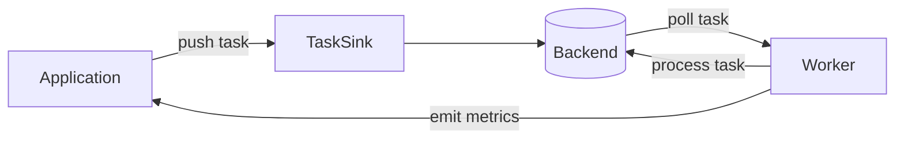
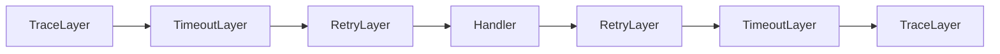

Apalis is designed around a small number of composable abstractions that fit together cleanly. Once you understand the three core layers — [**backends**](/docs/guides/backend/introduction), [**workers**](/docs/guides/workers/introduction), and [**middleware**](/docs/guides/workers/middleware) — every other concept in the documentation is a natural extension of them.

This page gives you a structural map of the whole system before you dive into the details.

---

## The Big Picture


Three things happen in every Apalis deployment:

1. [**Tasks are pushed**](/docs/guides/backend/pushing-tasks) into a backend via `TaskSink` — encoded, wrapped in a `Task` envelope, and written to storage
2. **A worker polls** the backend for tasks, drives them through a [middleware stack](/docs/guides/workers/middleware), and hands them to your handler function
3. **The backend receives heartbeats** from the worker so it can detect stalled workers and requeue their tasks

Everything else — workflows, shared connections, observability, piping — is built on top of these three interactions.

---

## Core Abstractions

### The Task Envelope

Every job in Apalis is wrapped in a [`Task<Args>`](https://crates.io/crates/apalis-core/1.0.0#tasks) before it touches any backend. The envelope carries **`Args`** — your job data (an email address, a user ID, a struct).

Your handler function only receives `Args` (and optionally injectable extras like `WorkerContext` or `Data<T>`). The envelope is managed by the runtime — you never construct or inspect it directly unless you need the advanced push methods in `TaskSink`.

---

### The Backend

A backend is anything that can store and deliver tasks. It is defined by two traits:

- **[`Backend`](/docs/guides/backend/introduction)** — the runtime contract: `poll_next()` for a stream of tasks, `middleware()` for the layer stack
- **[`BackendExt`](/docs/guides/backend/introduction)** — Composition of new backends like


The separation between `Backend` and `BackendExt` is intentional. Worker logic depends only on `Backend` — it does not care how tasks are serialized. `TaskSink` and advanced tooling depend on `BackendExt` to access the codec. You can swap serialization formats without changing your handler.

Currently supported backends:

| Backend | Storage | Durability |
|---|---|---|
| `apalis-postgres` | PostgreSQL | ✅ Persistent |
| `apalis-mysql` | MySQL / MariaDB | ✅ Persistent |
| `apalis-sqlite` | SQLite | ✅ Persistent |
| `apalis-redis` | Redis | ✅ Persistent |
| `apalis-cron` | In-memory schedule | ⚡ Ephemeral — use [`pipe_to`](/docs/advanced-concepts/piping-streams) for durability |
| `apalis-amqp` | AMQP broker | ✅ Persistent |
| `apalis-nats` | NATS | ✅ Persistent |
| `apalis-rsmq` | RsMq | ✅ Persistent |
| `apalis-pgmq` | Pgmq | ✅ Persistent |

---

### The Worker

A worker drives a backend's task stream through a Tower service stack and into your handler. It is built with [`WorkerBuilder`](https://docs.rs/apalis-core/1.0.0/apalis_core/worker/builder/index.html):
```
WorkerBuilder::new("name")
    .backend(B)       →  sets the task source
    .layer(L)         →  wraps the service stack with middleware
    .data(D)          →  injects shared data into the task context
    .build(handler)   →  compiles everything into a Worker
```

Internally, the worker runs a loop:
```rust
impl Stream for Worker
{
    fn poll_next(self: Pin<&mut Self>, cx: &mut Context<'_>)
        -> Poll<Option<Self::Item>>
    {
        // 1. Backend ready?
        ready!(backend.poll_ready(cx))?;

        // 2. Service ready?
        ready!(service.poll_ready(cx))?;

        // 3. Get task, run service
        let task = ready!(backend.poll_next(cx))?;
        queue.push(service.call(task));
    }
}
```
---

### The Middleware Stack

Middleware in Apalis is plain Tower middleware. Each `.layer()` call wraps the current service, producing a stack where the first layer declared is the outermost. Execution flows inward to the handler and back out:


Because middleware is composable Tower services, anything in the Tower ecosystem — [rate limiting](https://docs.rs/apalis/1.0.0/apalis/layers/trait.WorkerBuilderExt.html#tymethod.rate_limit), [circuit breaking](/docs/guides/workers/middleware#circuit-breaker), [load shedding](https://docs.rs/tower/latest/tower/load_shed/index.html), custom instrumentation — works without modification. See [Middleware Order](/docs/guides/workers/order-of-middleware) for guidance on stacking layers correctly.

---

## Other Capabilities

### Observability — `Expose`

Any backend that implements `ListQueues`, `ListWorkers`, `ListTasks`, `ListAllTasks`, and `Metrics` automatically satisfies the `Expose` trait — and can be registered with `apalis-board` for real-time dashboard visibility. See [Exposing Backends](/docs/guides/backend/maintainance) and [Web UI](/docs/products/web-board).

### Shared Connections — `BackendFactory`

When multiple workers share the same data store, `BackendFactory` lets them derive independent typed backends from a single underlying connection — avoiding the overhead of one connection per worker. See [Shared Connections](/docs/guides/backend/shared-backend).

### BackendExt — `BackendExt`

`BackendExt` provides composable combinators such as `before_start`, `map_err`, `with_codec` and `poll_with` among others.

### Workflows

For multi-step jobs, `apalis_workflow` provides two higher-level backend types that both implement `Backend` and slot into a standard `WorkerBuilder`:

- [**`SteppedFlow`**](/docs/guides/workflows/sequential-workflow) — a linear pipeline of typed async steps connected with combinators (`and_then`, `filter_map`, `fold`, etc.)
- [**`GraphFlow`**](/docs/guides/workflows/dag-workflow) — a directed acyclic graph where independent steps run in parallel and dependent steps wait only for their specific inputs

See [Sequential Workflows](/docs/guides/workflows/sequential-workflow) and [DAG Workflows](/docs/guides/workflows/dag-workflow).

---

## Task Lifecycle

Tracing a single task from push to completion:

```
1. Application calls backend.push(email)
      │
      ▼
2. Codec encodes Email → Vec<u8>
      │
      ▼
3. Task<Vec<u8>> written to storage
      │
      ▼  (worker polls on interval)
4. Backend::poll_next yields Task<Email>
      │  (codec decodes on the way out)
      ▼
5. Readiness check (LifecycleService::poll_ready)
      │  worker is not ready if it is shutting down, paused,
      │  or the inner service is pending
      ▼
6. LifecycleService::call
      │  clones the task's attempt counter and status handle
      │  registers the task with the WorkerContext
      │  calls the inner service and wraps its future in a LifecycleFuture
      ▼
7. Task enters middleware stack
      │  TraceLayer opens span
      │  TimeoutLayer starts deadline
      │  RetryLayer wraps inner call
      ▼
8. LifecycleFuture is first polled
      │  attempt counter incremented, status → Running
      │  (task-context feature) on every poll, a cancelled task
      │  is set to Killed and fails with AbortError
      ▼
9. Handler receives Email, processes it
      │
      ▼
10. Result (Ok / Err) bubbles back through middleware
      │  RetryLayer: re-submits on Err if attempts remain
      │  TimeoutLayer: cancels if deadline exceeded
      │  TraceLayer: closes span with outcome
      ▼
11. LifecycleFuture maps the result to a Status
      │  Ok                              → Done
      │  AbortError                      → Killed
      │  RetryAfterError / DeferredError → Pending
      │  any other Err                   → Failed
      │  (task-context feature) if completing the task context fails,
      │  status → Killed and the state error replaces the result
      ▼
12. LifecycleFuture is dropped
      │  task removed from the worker's context
      │  if no tasks remain, the worker is woken
      ▼
13. Backend acknowledges the task using its final status
      │
      ▼
14. Heartbeat continues — worker signals liveness
```

### Status transitions

| Outcome | Final status |
|---|---|
| Handler returns `Ok` | `Done` |
| Handler returns `AbortError`, or the task is cancelled | `Killed` |
| Handler returns `RetryAfterError` or `DeferredError` | `Pending` |
| Handler returns any other error | `Failed` |

Cancellation is cooperative: it is checked each time the task future is polled, so a task that never yields won't observe it until its next poll.

---

## Crate Structure

Apalis is split into focused crates so you only compile what you need:

| Crate | Role |
|---|---|
| `apalis-core` | `Backend`, `Worker`, `Task`, codec traits |
| `apalis` | Re-exports core plus built-in layers (tracing, retry, timeout, etc.) |
| `apalis-workflow` | `SteppedFlow` and `GraphFlow` backend implementations |
| `apalis-codec` | `JsonCodec`, `MsgPackCodec`, `BincodeCodec` |
| `apalis-board` | Web dashboard API and frontend |
| `apalis-postgres` | PostgreSQL backend |
| `apalis-sqlite` | SQLite backend |
| `apalis-redis` | Redis backend |
| `apalis-cron` | Cron schedule stream source |
| *(others)* | MySQL, AMQP, NATS, RSMQ, PGMQ backends |
