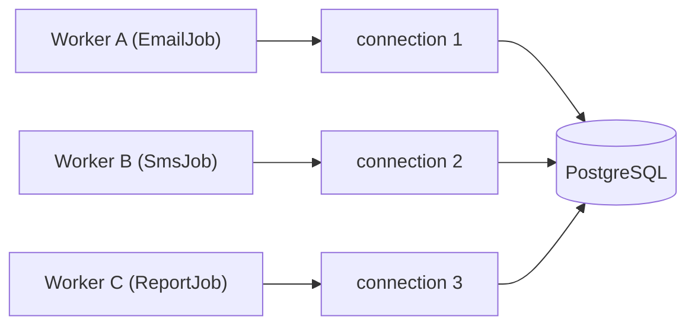
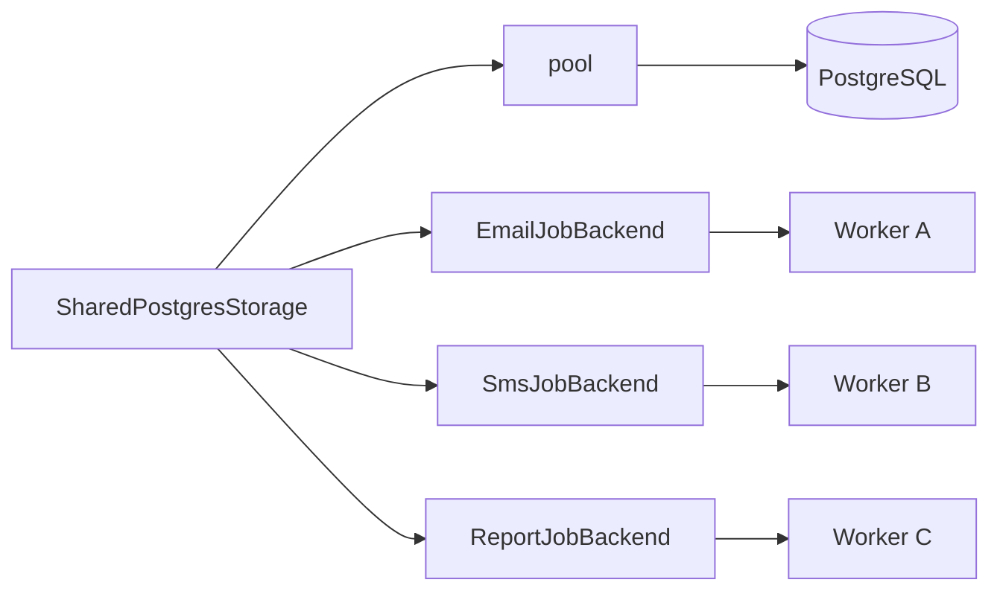

When running multiple workers against the same data store, opening a separate connection per worker is wasteful. Apalis's [`BackendFactory`](#the-backendfactory-trait) trait solves this by letting you create multiple typed backend instances from a single underlying connection — so your PostgreSQL pool, Redis client, or custom store is shared rather than duplicated.

> **Rule of thumb:** if you have more than one job type backed by the same database or broker, use a shared connection.

---

## The `BackendFactory` Trait

```rust
/// Trait for creating backend instances, generic over job-type arguments.
pub trait BackendFactory<Args> {
    /// The backend type produced by this factory.
    type Backend: Backend + BackendConfig<Args = Args>;

    /// The error returned if backend creation fails.
    type Error;

    /// Create a backend using `Config::default()`.
    fn create(&mut self) -> Result<Self::Backend, Self::Error>
    where
        <Self::Backend as BackendConfig>::Config: Default,
    {
        self.create_with_config(Default::default())
    }

    /// Create a backend using the given configuration.
    fn create_with_config(
        &mut self,
        config: <Self::Backend as BackendConfig>::Config,
    ) -> Result<Self::Backend, Self::Error>;
}
```

### Associated Types

| Type | Purpose |
|---|---|
| `Backend` | The typed backend instance handed to a [`WorkerBuilder`]. It must implement both [`Backend`](/docs/guides/backend/introduction) and `BackendConfig<Args = Args>` |
| `Error` | Returned if the backend cannot be created, for example if the underlying connection is no longer healthy |

Unlike the previous `MakeShared` trait, the factory no longer declares its own `Config` type. The configuration type is defined by the backend through `BackendConfig`, and the factory simply accepts `<Self::Backend as BackendConfig>::Config`. This keeps a backend's configuration the same whether you build it directly or through a factory.

`create()` is a convenience wrapper around `create_with_config` that uses `Config::default()`, so it is only available when the backend's config implements `Default`. Call `create_with_config` directly when you need per-worker tuning.

---

## Why Share Connections?

Without shared connections, each worker independently manages its own connection to the backend:



With `BackendFactory`, a single connection (or pool) is distributed across all workers:



This means:
- **Fewer open connections** to your data store
- **Lower memory overhead** per worker
- **Consistent configuration** — one place to set pool size, timeouts, and credentials

---

## Postgres Example

The following example runs two workers — one processing `HashMap` jobs, one processing `i32` jobs — over a single shared `PgPool`.

```rust fileName="main.rs" mode="compile"
use std::{collections::HashMap, time::Duration};

use apalis::prelude::*;
use apalis_postgres::{factory::PostgresStorageFactory, *};
use futures::stream;

#[tokio::main]
async fn main() {
    // 1. Create the underlying connection pool once.
    let pool = PgPool::connect(&std::env::var("DATABASE_URL").unwrap())
        .await
        .unwrap();

    // 2. Run schema migrations if this is first use.
    PostgresStorage::setup(&pool).await.unwrap();

    // 3. Wrap the pool in a PostgresStorageFactory — the single source of truth.
    let mut store = PostgresStorageFactory::new(pool);

    // 4. Create a typed backend for each job type.
    //    Each call to create() returns an independent Backend
    //    that shares the underlying pool.
    let mut map_store = store.create().unwrap();
    let mut int_store = store.create().unwrap();

    // 5. Enqueue some tasks.
    map_store
        .push_stream(&mut stream::iter(vec![HashMap::<String, String>::new()]))
        .await
        .unwrap();
    int_store.push(99).await.unwrap();

    // 6. A generic handler — each worker uses the same function signature.
    async fn send_reminder<T>(
        _: T,
        _task_id: TaskId,
        wrk: WorkerContext,
    ) -> Result<(), BoxDynError> {
        tokio::time::sleep(Duration::from_secs(2)).await;
        wrk.stop().unwrap();
        Ok(())
    }

    // 7. Build workers from the created backends.
    let int_worker = WorkerBuilder::new("worker-int")
        .backend(int_store)
        .build(send_reminder);

    let map_worker = WorkerBuilder::new("worker-map")
        .backend(map_store)
        .build(send_reminder);

    // 8. Run both workers concurrently.
    tokio::try_join!(int_worker.run(), map_worker.run()).unwrap();
}
```

### What's happening step by step

1. A single `PgPool` is created — this is the only point of contact with the database.
2. `PostgresStorageFactory::new(pool)` wraps it in the `BackendFactory`-capable store type.
3. Each `create()` call produces an independent `Backend` parameterised over a different `Args` type — `HashMap<String, String>` and `i32` here.
4. Tasks are pushed via [`TaskSink`](/docs/backend/pushing-tasks) as normal; created backends implement the same push interface.
5. Two workers are built and run concurrently with `tokio::try_join!`. If either worker errors, both are cancelled.

---

## Using Custom Configuration

When you need per-backend tuning — such as a different poll interval or queue name — use `create_with_config`:

```rust
let config = Config {
    heartbeat_interval: Duration::from_millis(1000),
    ..Default::default()
};

let mut fast_store = store.create_with_config(config).unwrap();
```

The available fields in the config depend on the backend's `BackendConfig` implementation. Refer to the backend-specific documentation for the full list of options.

---

## Implementing `BackendFactory` for a Custom Backend

If you are building your own backend, implement `BackendFactory` by cloning or reference-counting the underlying connection. The backend type it produces must implement both `Backend` and `BackendConfig<Args = Args>`, and the config type is declared on `BackendConfig`:

```rust
use apalis::prelude::*;

struct MySharedBackend<Args> {
    pool: Arc<MyConnectionPool>,
    _phantom: PhantomData<Args>,
}

// The backend declares its own config through BackendConfig.
impl<Args> BackendConfig for MyBackend<Args> {
    type Args = Args;
    type Config = MyBackendConfig;
    // ...
}

impl<Args> BackendFactory<Args> for MySharedBackend<Args> {
    type Backend = MyBackend<Args>;
    type Error = MyError;

    fn create_with_config(
        &mut self,
        config: <Self::Backend as BackendConfig>::Config,
    ) -> Result<Self::Backend, Self::Error> {
        Ok(MyBackend::new(Arc::clone(&self.pool), config))
    }
}
```

The key pattern: the shared wrapper holds an `Arc` (or equivalent) to the resource, and each `create_with_config` call clones only the reference — not the connection itself.

---

## Migrating from `MakeShared`

`BackendFactory` replaces `MakeShared`:

| Before | After |
|---|---|
| `MakeShared<Args>` | `BackendFactory<Args>` |
| `make_shared()` | `create()` |
| `make_shared_with_config(cfg)` | `create_with_config(cfg)` |
| `type MakeError` | `type Error` |
| `type Config` on the factory | `BackendConfig::Config` on the backend |

---

## Summary

| Method | When to use |
|---|---|
| `create()` | Multiple workers, default configuration |
| `create_with_config(cfg)` | Multiple workers, per-worker tuning needed |

`BackendFactory` is the idiomatic Apalis pattern for running several job queues against the same data store without multiplying connection overhead. Pair it with `tokio::try_join!` to run all workers concurrently from a single entry point.
